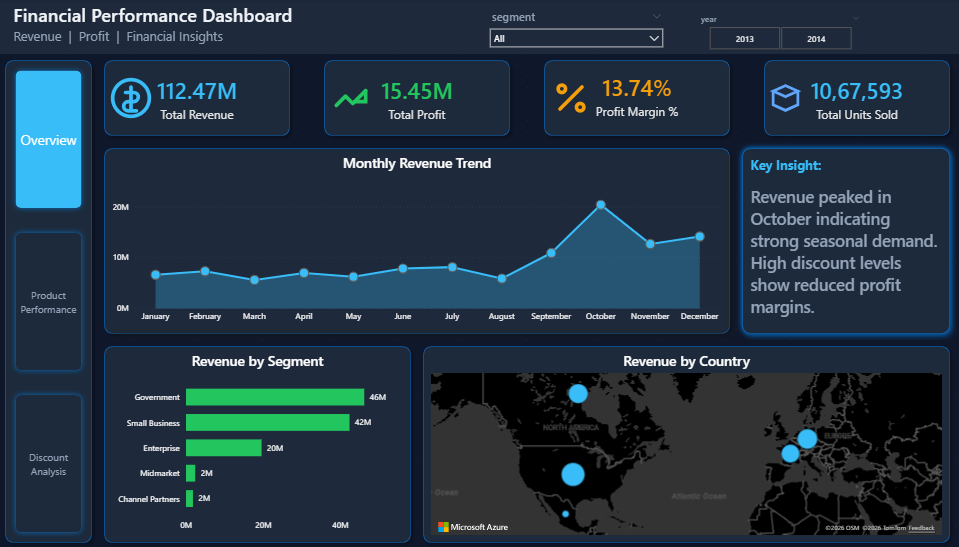

# 📊 Financial Performance & Profitability Analytics Dashboard
### End-to-End Data Analytics Project | MySQL | SQL | Power BI | Excel

## 📌 Project Overview

This project focuses on analyzing financial performance, revenue trends, product profitability, and discount strategies using **MySQL and Microsoft Power BI**.

The objective is to transform raw financial data into meaningful business insights that help organizations monitor financial performance, identify profitable products, evaluate discount effectiveness, and make data-driven business decisions.

The project follows an end-to-end data analytics workflow, including database creation, data preparation, SQL-based analysis, KPI calculations, and interactive dashboard development.

## 🎯 Business Problem Statement

Businesses often face challenges in understanding their financial performance, identifying profitable products, and evaluating whether their discount strategies are generating sustainable profits.

Increasing sales revenue does not necessarily result in higher profitability, as excessive discounting can reduce profit margins. Without a centralized reporting solution, stakeholders may find it difficult to monitor financial trends and identify opportunities for improvement.

The business requires an interactive analytics solution to:

- Monitor overall revenue, profit, and profit margins.
- Identify products contributing the most to business profitability.
- Analyze monthly revenue and profit trends.
- Evaluate the impact of discount levels on revenue and profitability.
- Compare financial performance across business segments and countries.
- Identify opportunities to optimize product pricing and discount strategies.

**Business Goal:** Develop an interactive financial analytics dashboard that provides visibility into financial performance, product profitability, and discount effectiveness to support informed business decisions.

## 🛠️ Tools & Technologies

| Category | Technologies |
|---|---|
| Database | MySQL |
| Data Analysis | SQL |
| Data Visualization | Microsoft Power BI |
| Data Preparation | Microsoft Excel |
| Version Control | Git & GitHub |

## 📊 Dashboard Pages & Analysis

The project consists of three interactive dashboard pages designed to analyze financial performance from different business perspectives.

### 1. Financial Overview Dashboard

Provides an executive-level summary of financial performance, helping stakeholders monitor revenue, profitability, monthly trends, and geographical performance.

**Key Features:**
- Total Revenue KPI
- Total Profit KPI
- Profit Margin %
- Total Units Sold
- Monthly Revenue Trend Analysis
- Revenue by Business Segment
- Revenue by Country (Map Visualization)
- Key Business Insights
- Segment and Year Filters

**Key Business Insights:**

- Revenue peaked in October, indicating a seasonal sales pattern.
- Government is the leading business segment in revenue contribution.
- Higher discount levels are associated with reduced profit margins.

**Dashboard Preview:**



---

### 2. Product Performance Dashboard

Analyzes product-level financial performance to identify top-performing products, compare revenue and profit contributions, and evaluate product profitability.

**Key Features:**
- Total Products KPI
- Total Product Profit
- Average Profit per Product
- Top Performing Product
- Profit by Product
- Revenue vs. Profit by Product
- Product Profitability Scatter Chart
- Product Profitability Matrix
- Product, Segment, and Year Filters

**Key Business Insights:**

- Paseo generates the highest total profit among the analyzed products.
- VTT and Amarilla also contribute significantly to overall profitability.
- Product-level comparisons help identify lower-margin products that may require pricing optimization.

**Dashboard Preview:**


---

### 3. Discount Impact Analysis Dashboard

Evaluates how different discount levels influence revenue, sales volume, and profitability to understand the effectiveness of discount strategies.

**Key Features:**
- Discount Revenue KPI
- Profit After Discount KPI
- Average Discount Impact
- Profit Margin %
- Revenue and Profit by Discount Band
- Profit Margin by Discount Level
- Units Sold by Discount Level
- Discount Performance Matrix
- Segment, Year, and Country Filters

**Key Business Insights:**

- High discount levels generate substantial revenue but have the lowest profit margin.
- The High discount band records a profit margin of approximately 7.20%.
- The None discount band achieves the highest profit margin of approximately 23.62%.
- Low and Medium discount bands maintain better profit margins than the High discount band.

**Dashboard Preview:**


---

## 🧮 SQL Data Processing & Analysis

MySQL was used to create the database, prepare financial data, perform analytical calculations, and generate structured data for Power BI reporting.

**Key SQL Operations:**

| Step | SQL Operations |
|---|---|
| 1 | Created the MySQL database `financialanalyticsdb`. |
| 2 | Created the `financial_data` table with appropriate data types. |
| 3 | Identified invalid records using filtering conditions. |
| 4 | Detected duplicate records using `GROUP BY` and `HAVING`. |
| 5 | Created a cleaned table using `ROW_NUMBER()` to retain one record per defined duplicate group. |
| 6 | Calculated financial KPIs using aggregate functions. |
| 7 | Analyzed revenue and profit by business segment. |
| 8 | Analyzed financial performance by country. |
| 9 | Calculated monthly revenue and profit trends. |
| 10 | Evaluated product-level revenue and profitability. |
| 11 | Analyzed discount-level revenue, profit, and profit margins. |
| 12 | Created `financial_dashboard_view` for dashboard reporting. |
| 13 | Retrieved the final dashboard dataset from the SQL view. |

**SQL Concepts Used:**

- CREATE DATABASE and CREATE TABLE
- SELECT and WHERE
- GROUP BY and HAVING
- Aggregate Functions: SUM(), AVG(), COUNT()
- ROUND() for financial calculations
- ORDER BY
- Window Functions: ROW_NUMBER()
- CREATE TABLE AS SELECT
- CREATE VIEW

## 📈 Key Business Metrics

| Metric | Business Purpose |
|---|---|
| Total Revenue | Measures overall sales performance. |
| Total Profit | Evaluates business profitability. |
| Profit Margin % | Measures profit relative to revenue. |
| Total Units Sold | Tracks overall sales volume. |
| Average Discount | Measures the average recorded discount value. |
| Revenue by Segment | Compares business segment performance. |
| Profit by Product | Identifies profitable products. |
| Monthly Revenue | Tracks monthly revenue trends. |
| Discount Impact | Evaluates discount effectiveness. |

## 💡 Business Insights & Recommendations

The dashboard supports the following business decisions:

1. **Financial Performance:** Monitor revenue and profit trends to evaluate overall business performance.
2. **Product Optimization:** Identify high-profit products and evaluate opportunities to improve lower-margin products.
3. **Discount Optimization:** Analyze discount bands to avoid excessive discounting that negatively affects profit margins.
4. **Seasonal Planning:** Use monthly revenue trends to understand seasonal performance and support sales planning.
5. **Segment Analysis:** Compare business segment and geographical performance to identify potential growth opportunities.

## 📂 Project Folder Structure

```text
Financial-Performance-Analytics/
│
├── Dataset/
│   └── Financial_Sample.xlsx
│
├── SQL/
│   └── financial_analysis.sql
│
├── Dashboard/
│   └── Financial_Performance_Dashboard.pbix
│
├── Images/
│   ├── Overview.png
│   ├── Product Performance.png
│   └── Discount Analysis.png
│
└── README.md
```

## 🚀 How to Use This Project

1. Download the financial dataset from the Dataset folder.
2. Create the database and financial table using the SQL script.
3. Import the Excel dataset into the MySQL table.
4. Execute the SQL queries to perform data validation, duplicate handling, and financial analysis.
5. Connect the processed data or SQL view to Power BI.
6. Open the `.pbix` file from the Dashboard folder.
7. Explore the interactive dashboards using available slicers and filters.

## 📌 Skills Demonstrated

- **SQL:** Database Creation, Data Validation, Duplicate Detection, Window Functions, Aggregations, Views, Financial Queries.
- **Power BI:** Interactive Dashboards, KPI Development, Data Modeling, Data Visualization, Business Reporting.
- **Excel:** Dataset Inspection and Data Preparation.
- **Business Analytics:** Financial Analysis, Revenue Analysis, Product Profitability, Discount Analysis.
- **Data Storytelling:** Business Insights, Performance Monitoring, Data-Driven Recommendations.

## 👩‍💻 Author

**Bhagyashree Katale**

Aspiring Data Analyst | SQL | Power BI | Python | Excel

- GitHub: [Bhagyashreekatale1](https://github.com/Bhagyashreekatale1)
- LinkedIn: [Bhagyashree Katale](https://www.linkedin.com/in/bhagyashree-katale-6b6256357/)

---

## ⭐ Project Summary

Developed an end-to-end Financial Performance & Profitability Analytics Dashboard using **MySQL and Power BI** to analyze financial performance, monthly revenue trends, product profitability, and discount effectiveness.

Implemented SQL-based data validation, duplicate handling, financial KPI calculations, and analytical queries. Built three interactive Power BI dashboards to identify business trends, evaluate product performance, and assess the impact of discount strategies on profitability.
