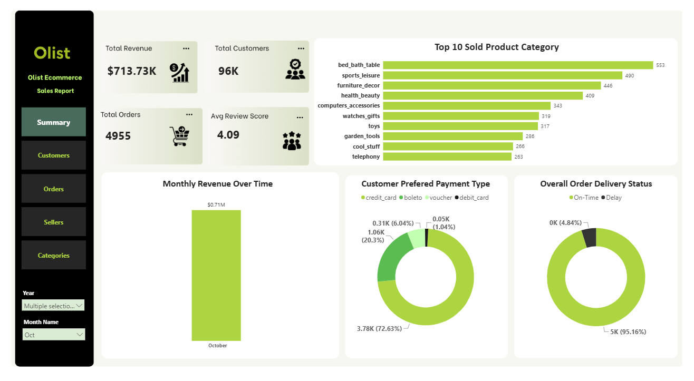
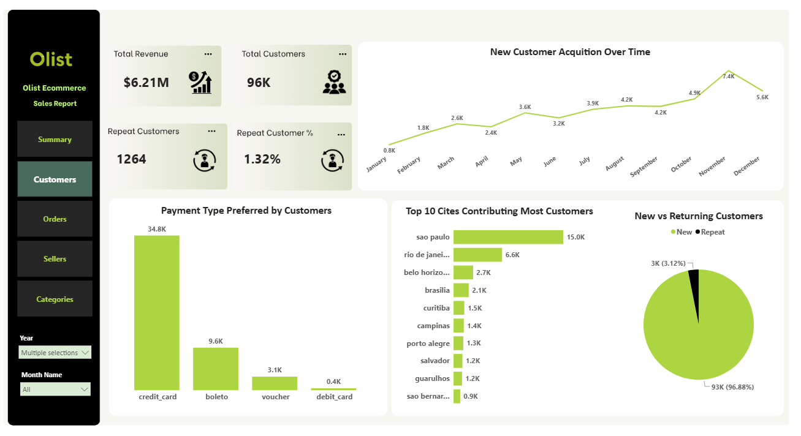
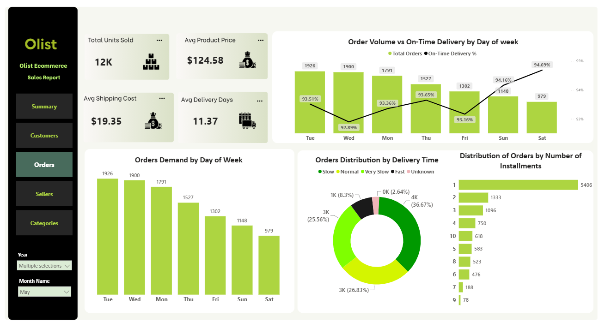
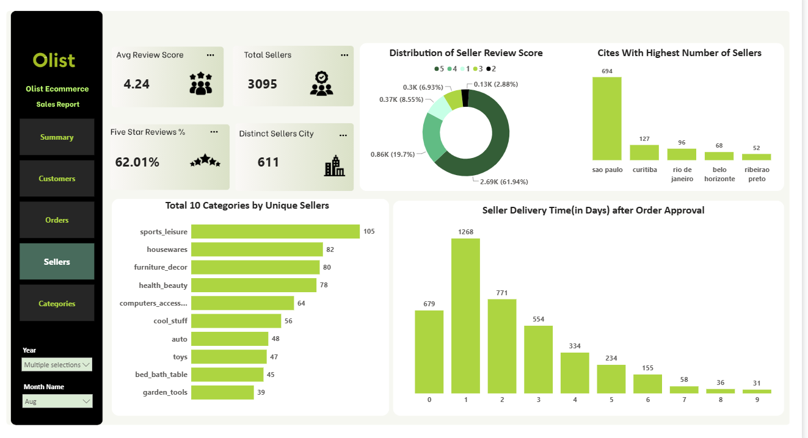
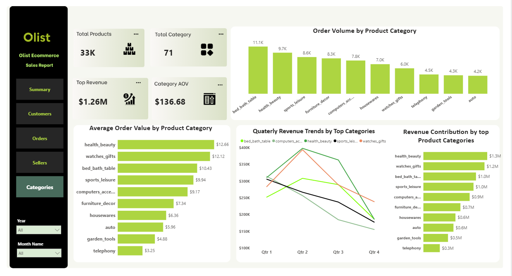

# Olist E-Commerce Sales & Business Analytics

An end-to-end data analytics project using the **Olist Brazilian E-Commerce Dataset** to analyze sales performance, customer behavior, order trends, seller performance, and product categories.

This project demonstrates a complete analytics workflow using **PostgreSQL, SQL, Power BI, and DAX**, transforming raw e-commerce data into meaningful business insights through data validation, exploratory analysis, and interactive dashboards.

---

## 1. Project Overview

The objective of this project is to analyze Olist's e-commerce operations and evaluate business performance across customers, orders, sellers, and product categories.

Using SQL and Power BI, the project explores transactional data, identifies business trends, and presents actionable insights through interactive dashboards.

## 2. Business Problem

E-commerce businesses generate large amounts of transactional data, but raw data alone does not provide a clear understanding of business performance.

Olist needs to understand how sales are performing, which customer segments and locations contribute to business activity, how efficiently orders are delivered, and which sellers and product categories perform best.

Without proper data analysis, identifying operational issues, understanding customer behavior, and making informed business decisions becomes difficult.

**This project addresses these challenges by analyzing e-commerce data and developing interactive dashboards that help answer important business questions.**

### Business Objectives

- Evaluate overall sales performance and order trends.
- Identify customer distribution and purchasing patterns.
- Analyze order status and delivery performance.
- Compare seller performance across different locations.
- Identify high-performing product categories.
- Understand payment methods and customer review patterns.
- Present key business KPIs through interactive dashboards.

## 3. Data Sources

This project uses the publicly available **Olist Brazilian E-Commerce Dataset** from Kaggle.

- **Dataset:** [Olist Brazilian E-Commerce Dataset](https://www.kaggle.com/datasets/olistbr/brazilian-ecommerce)
- **Source:** Kaggle

The dataset contains information about orders, customers, sellers, products, payments, reviews, geolocation, and product category translations.

**Note:** The original dataset files are not included in this repository due to their large file size. Download the dataset directly from Kaggle using the link above to reproduce the analysis.

## 4. Project Workflow

1. **Data Collection** – Obtained the Olist e-commerce dataset from Kaggle.
2. **Database Creation** – Created a PostgreSQL database and structured tables for the dataset.
3. **Data Loading** – Imported CSV files into PostgreSQL.
4. **Data Validation** – Checked missing values, duplicate records, data consistency, and invalid values.
5. **SQL Analysis** – Performed exploratory analysis using joins, aggregations, subqueries, and window functions.
6. **Power BI Development** – Connected analytical data to Power BI and developed interactive dashboards.
7. **DAX Measures** – Created measures for business KPIs and performance analysis.

## 5. Project Structure

```text
Olist-Ecommerce-Sales-Business-Analytics/
│
├── Dataset/
│   └── README.md
│
├── SQL/
│   ├── Create_Tables.sql
│   ├── Load_Dataset.sql
│   ├── Data_Validation.sql
│   └── Exploratory_Data_Analysis.sql
│
├── DAX_Measures/
│   └── DAX_Measures.dax
│
├── Dashboard/
│   └── Screenshots/
│       ├── Summary.png
│       ├── Customers.png
│       ├── Orders.png
│       ├── Sellers.png
│       └── Categories.png
│
└── README.md
```

## 6. SQL Analysis

PostgreSQL was used to create the database, load the dataset, validate records, and perform business-focused analysis.

Key analysis areas include:

- **Customer Analysis:** Customer distribution, location-based analysis, and purchasing behavior.
- **Order Analysis:** Order trends, order status, and delivery performance.
- **Seller Analysis:** Seller distribution and seller-level performance.
- **Product & Category Analysis:** Product distribution, category-level sales, and product performance.
- **Payment Analysis:** Payment types, payment values, and installment patterns.
- **Review Analysis:** Customer ratings and review trends.

## 7. Power BI Dashboard

An interactive Power BI dashboard was developed to analyze e-commerce business performance across five analytical pages.

### Dashboard Pages

1. **Summary** – Overall business performance and key performance indicators.
2. **Customers** – Customer distribution and geographic analysis.
3. **Orders** – Order trends, order status, and delivery performance.
4. **Sellers** – Seller distribution and performance analysis.
5. **Categories** – Product category analysis and sales performance.

### Dashboard Screenshots

#### 1. Summary



#### 2. Customers



#### 3. Orders



#### 4. Sellers



#### 5. Categories



## 8. Power BI Dashboard File

The Power BI dashboard file (`.pbix`) is hosted externally due to GitHub file size considerations.

**Download:** [Olist E-Commerce Power BI Dashboard](https://drive.google.com/file/d/1YamLfUYkdvhCPrapq5HWWZfsi552tGZK/view))

Download the file and open it using Power BI Desktop to explore the interactive dashboard.

## 9. DAX Measures

DAX measures are used to calculate business KPIs and support interactive dashboard analysis.

The DAX measures file is available in the `DAX_Measures` folder.

## 10. Tools & Technologies

| Category | Tools |
|---|---|
| Database | PostgreSQL |
| Query Language | SQL |
| Data Visualization | Microsoft Power BI |
| Calculations | DAX |
| Data Transformation | Power Query |
| Data Source | Olist Brazilian E-Commerce Dataset |
| Version Control | Git & GitHub |

## 11. Key Takeaways

- Evaluated e-commerce sales and order performance.
- Analyzed customer distribution and purchasing behavior.
- Examined order fulfillment and delivery performance.
- Identified seller and product category performance patterns.
- Developed interactive dashboards to communicate business KPIs.
- Applied SQL and Power BI to convert raw data into business insights.

## 12. Project Outcome

Developed an end-to-end e-commerce analytics solution that transforms raw transactional data into structured business insights using **PostgreSQL, SQL, Power BI, and DAX**.
