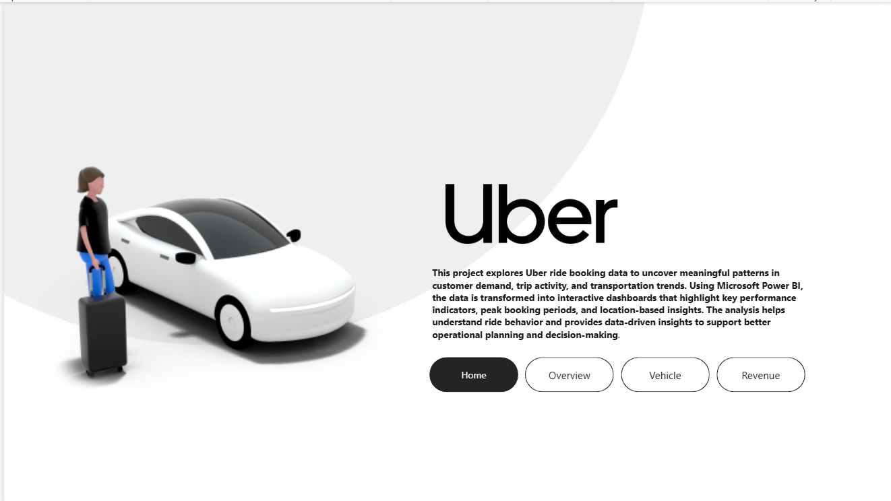
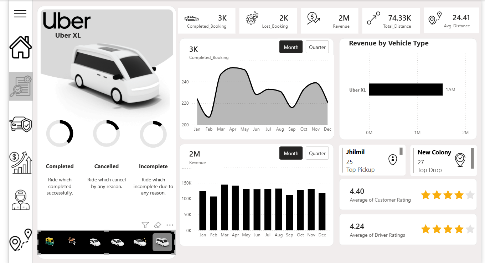
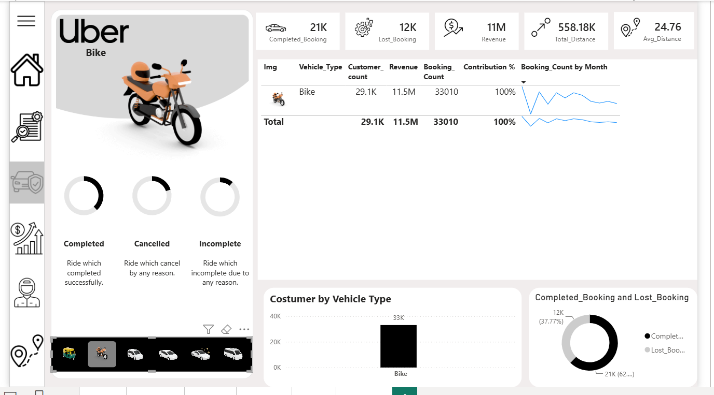
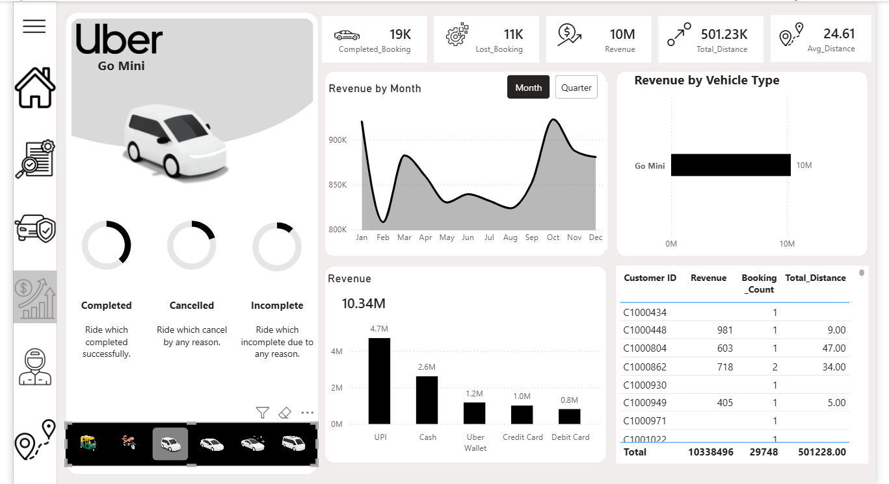

# 🚕 Uber Rides Analysis Dashboard using Power BI

## 📌 Project Overview

This project focuses on analyzing Uber ride booking data to understand booking performance, revenue trends, customer behavior, vehicle utilization, ride cancellations, and location-based demand.

Using Microsoft Power BI, the project transforms raw ride data into interactive dashboards that help identify business trends, evaluate operational performance, and generate meaningful insights to support data-driven decision-making.

## 🎯 Business Problem Statement

Ride-hailing businesses operate in a dynamic environment where customer demand, vehicle availability, revenue generation, and ride cancellations directly influence operational efficiency and business performance.

Understanding these factors is essential for improving service quality, optimizing vehicle utilization, identifying revenue opportunities, and enhancing customer satisfaction.

The goal of this analysis is to:

- Analyze completed and lost bookings to understand overall booking performance.
- Identify peak booking hours, busy days, and high-demand pickup and drop-off locations.
- Evaluate revenue contribution across different vehicle types and payment methods.
- Analyze customer behavior, including first-time, returning, and regular riders.
- Investigate ride cancellation patterns and identify major cancellation reasons.
- Assess vehicle utilization and performance to support better resource allocation.
- Evaluate customer and driver ratings to understand service quality.

## 🎯 Project Objectives

- Monitor overall ride booking performance through key performance indicators.
- Analyze monthly booking and revenue trends.
- Identify high-performing vehicle categories.
- Understand customer booking and retention patterns.
- Examine geographical demand and busy time slots.
- Provide actionable insights to improve operational efficiency and business performance.

## 📊 Dashboard Pages & Key Insights

### 1. 🏠 Home Dashboard

- Interactive dashboard landing page.
- Navigation buttons for different analysis sections.
- Overview of the report and key information.

### 2. 📈 Overview Dashboard

- Total Completed Bookings
- Lost Bookings
- Total Revenue
- Total Distance
- Average Distance
- Monthly Booking Trends
- Revenue by Vehicle Type
- Top Pickup and Drop Locations
- Customer and Driver Ratings

### 3. 🚗 Vehicle Analysis

- Revenue by Vehicle Type
- Customer Count
- Booking Count
- Vehicle Contribution Percentage
- Monthly Booking Trends
- Completed vs. Lost Bookings
- Vehicle Performance Comparison

### 4. 💰 Revenue Analysis

- Monthly Revenue Trends
- Revenue by Vehicle Type
- Revenue by Payment Method
- Customer Revenue Details
- Total Ride Distance

## 📸 Dashboard Preview

### Home Dashboard



### Overview Dashboard



### Vehicle Analysis



### Revenue Analysis



## 🛠️ Tech Stack

- **Data Visualization:** Microsoft Power BI
- **Data Transformation:** Power Query
- **Data Analysis:** DAX Measures
- **Data Modeling:** Power BI Data Model
- **Data Source:** Microsoft Excel
- **Dashboard Features:** Bookmarks, Drill-through, Interactive Buttons, and Slicers

## 📂 Project Structure

```text
Uber-Rides-Analysis/
│
├── Dataset/
│   └── Uber Dataset.xlsx
│
├── Dashboard/
│   └── Uber Dashboard.pbix
│
├── Images/
│   ├── Home.png
│   ├── Overview.png
│   ├── Vehicle.png
│   └── Revenue.png
│
└── README.md
```

## 📁 Dataset Information

The project uses the Uber ride booking dataset provided in Excel format.

**File:** `Uber Dataset.xlsx`

The dataset supports analysis of:

- Ride bookings and booking status
- Revenue and payment methods
- Vehicle categories
- Customer and driver information
- Pickup and drop-off locations
- Ride distance and time
- Cancellation details
- Customer and driver ratings

## 📏 Key DAX Measures

The dashboard uses DAX measures to calculate important business metrics, including:

- Revenue
- Booking Count
- Completed Bookings
- Lost Bookings
- Customer Count
- Total Distance
- Average Distance
- Contribution Percentage
- First-Time Riders
- Returning Riders
- Regular Riders

## 💡 Key Business Insights

The analysis helps identify:

- Top-performing vehicle categories based on revenue and bookings.
- Monthly fluctuations in ride demand and revenue.
- Differences between completed and lost bookings.
- High-demand pickup and drop-off locations.
- Peak booking periods and busy time slots.
- Customer payment preferences and rider patterns.
- Major reasons behind ride cancellations.
- Customer and driver satisfaction through ratings.

## 🚀 How to Run

1. Clone the repository:

   ```bash
   git clone https://github.com/Bhagyashreekatale1/Data-Analyst.git
   ```

2. Navigate to the project folder:

   ```bash
   cd Data-Analyst/Uber-Rides-Analysis
   ```

3. Open `Uber Dashboard.pbix` from the `Dashboard/` folder using Microsoft Power BI Desktop.

4. If prompted, configure the Excel data source using `Dataset/Uber Dataset.xlsx`.

5. Refresh the data if required.

6. Explore the dashboard using interactive navigation buttons, filters, and slicers.

## 📈 Skills Demonstrated

- Data Analysis
- Business Intelligence
- DAX Calculations
- Power Query
- Data Modeling
- KPI Development
- Data Visualization
- Interactive Dashboard Design
- Business Problem Solving
- Analytical Thinking

## 👩‍💻 Author

**Bhagyashree Katale**

- **GitHub:** [Bhagyashreekatale1](https://github.com/Bhagyashreekatale1)
- **LinkedIn:** [Bhagyashree Katale](https://www.linkedin.com/in/bhagyashree-katale-6b6256357/)
